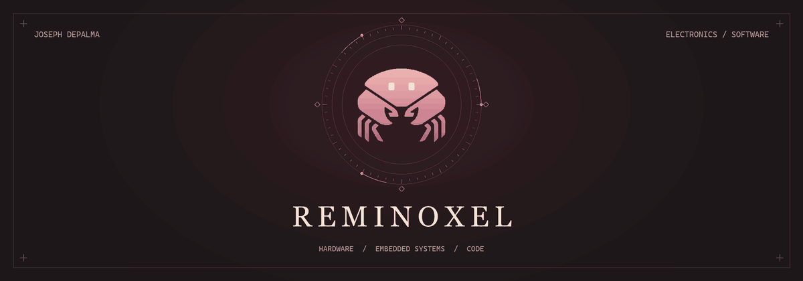

  <picture>
    <source media="(prefers-reduced-motion: reduce)" srcset="assets/regi-profile.png" />
    
  </picture>

<h1 align="center">Joseph DePalma</h1>

B.S. Computer Engineering · M.S. Computer Science

  <a href="#spirois">SpiroIS</a> ·
  <a href="#projects">Projects</a> ·
  <a href="#tools">Tools</a> ·
  <a href="#contact">Contact</a>

---

I'm Joseph, or Reminoxel here. I like working with hardware and software, especially when I get to build both. A lot of my work involves electronics R&D, embedded systems, prototyping, and testing. I like getting something working, finding out what breaks, and fixing it.

I also build a desktop assistant, work on my Minecraft mod, and get into games, VR, operating systems, and data projects.

## SpiroIS

SpiroIS is my **patent-pending** incentive spirometry project. The idea is to use a game to make respiratory therapy more interactive and easier to keep track of.

I work on its hardware prototypes, embedded software, integration, and testing.

## Projects

### Personal projects

| Project | What it is |
| :--- | :--- |
| **R.E.G.I: Residential Electronic Guidance Interface** | My local desktop assistant. Voice, memory, research, coding tools, and his own animated interface. The crab up top is him. |
| **[Rem's Enchantaporeum](https://www.curseforge.com/minecraft/mc-mods/rems-enchantaporeum)** | My Minecraft Forge mod. Enchantments for the stuff vanilla left out, from weapons and armor to workstations, mounts, and sticks. Some useful. Some ridiculous. I've also worked on progression, custom mechanics, and client/server testing. |

### Hardware & VR

| Project | What it is |
| :--- | :--- |
| **SpiroIS (Patent Pending)** | Gamified incentive spirometry, combining hardware, embedded software, integration, and validation. |
| **Military Stopwatch** | A stopwatch built in Verilog for an FPGA. |
| **Plant Alarm System** | Used sensors to monitor plant conditions and trigger alerts. |
| **VR Simulations & Games** | VR simulations and games built in Unity. |

### Systems, software & machine learning

| Project | What it is |
| :--- | :--- |
| **XV6 Kernel Modification** | Changes to the XV6 teaching kernel for an operating systems project. |
| **Multithreaded Chat Application** | A client-server chat app using networking and multiple threads. |
| **Parallel Prime Discovery** | Used parallel processing to find prime numbers more efficiently. |
| **Steam Reviews Sentiment Analysis** | Compared classical machine learning models with transformer models to classify Steam reviews. |
| **AIDev Database Analysis** | Database design using GitHub-style development data. Relational models, normalization, star schemas, and document models. |
| **Ethereum Fee Detective + Mini EVM Gas Arcade** | Ethereum gas fees and transaction behavior, with a small arcade-style simulation. |
| **Custom QR Code Design** | Made custom QR codes in Python with images and styling. |

### Data visualization

| Project | What it is |
| :--- | :--- |
| **[NYC Rat Sightings Data Visualization](https://github.com/Reminoxel/dataviz_final_project/tree/main/project-01)** | NYC rat sightings by borough, year, weekday, and location type. Rats are unfortunately good data. |
| **[Data Visualization Mini-Project 2](https://github.com/Reminoxel/dataviz_final_project/tree/main/project-02)** | Charts and maps in R using birth patterns, weather, spatial data, and model results. |
| **Spatial Data Visualization** | Mapped internet usage across countries in R using ggplot2 and spatial data. |
| **Essential Construction Data Visualization** | Compared NYC essential construction projects by borough and category. |
| **[Data Visualization & Reproducible Research](https://github.com/Reminoxel/dataviz_final_project)** | Revised earlier charts and added Tampa weather and concrete-strength analysis. Includes interactive charts, accessibility improvements, and reproducible reports. |

## Tools

| Area | What I use |
| :--- | :--- |
| **Code** | C · C++ · C# · Python · Java · R · SQL · MATLAB |
| **Hardware & embedded** | Microcontrollers · Arduino · firmware testing · hardware-software integration · FPGA / Verilog |
| **Data & databases** | RStudio · tidyverse · ggplot2 · spatial visualization · data cleaning · Oracle SQL · relational modeling |
| **Build & create** | Unity · Fusion 360 · Blender · GitHub · VS Code · Linux / Unix |

## Contact

[LinkedIn](https://www.linkedin.com/in/joseph-depalma-4942a52b4/) · [Joey.DePalma5797@gmail.com](mailto:Joey.DePalma5797@gmail.com) · [GitHub](https://github.com/Reminoxel)
